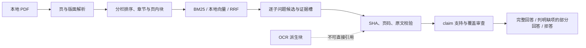

# PT3：claim 溯源、缺项与合成验收

日期：2026-10-23

## 保护措施

每个回答 claim 保留指向精确 PDF 版本 SHA-256、物理页码、原文短引文、解析块和解析版本的证据对象。引用前重新校验源文件哈希、页码和原文；OCR 派生块不作为可引用证据。部分回答保留通过支持审查的 claims，并在回答正文和结构化结果中列出未覆盖要点。支持与相关性审查失败的 claim 不会进入答案。

Hosted 与 Ollama 响应若因长度上限截断，现明确报告截断类型和已消耗 token；生成阶段最多进行一次紧凑格式重试。重试仍截断时失败关闭，不循环重试。重试和原请求都计入使用量。复杂问题的子问题覆盖和缺项清单继续作为独立结果返回。

## 冻结合成数据

PT3 使用两篇人工编写的双栏/多页 PDF，包含样本量、组间数值、相对差、跨论文比较、缺失信息和不可回答题。冻结题集有 6 题、7 条最小证据引文。PDF、问题、黄金答案和评分规则见：

- `evals/fixtures/pt3-synthetic/`
- `evals/pt3-synthetic-gold-20261023.jsonl`
- `evals/pt3-synthetic-manifest-20261023.json`

黄金集哈希和两个 PDF 哈希写入 manifest；生成脚本在检测到冻结文件后拒绝覆盖。黄金引文复现校验：

```powershell
python -m papertrail.gold --sources evals/fixtures/pt3-synthetic/sources.yaml --gold evals/pt3-synthetic-gold-20261023.jsonl --minimum-questions 1
```

## 单次模型运行与人工复核

只索引上述两个合成 PDF。模型使用 DeepSeek `deepseek-flash`；历史账本去重后再创建 `.local/pt-master-usage.json`，脚本不覆盖历史账本或已存在的运行报告，并将全局费用限制在 `$0.50`。

```powershell
$env:PAPERTRAIL_LLM_PROVIDER = 'openai-compatible'
$env:PAPERTRAIL_LLM_MODEL = 'deepseek-flash'
$env:PAPERTRAIL_OPENAI_BASE_URL = 'https://api.deepseek.com'
python scripts/evaluate_pt3_synthetic.py
python scripts/verify_pt3_report.py
```

运行结果及逐题人工审阅在 [PT3 合成评测报告](../../reports/pt3-synthetic-model-20261023.json)。运行共 27 次 API 请求，提示 14,065 tokens、生成 1,969 tokens，费用上界 `$0.0065823`；中位延迟约 3.87 秒。历史账本去重总额 `$0.3959673`，本次后累计 `$0.4025496 / $0.50`，尚余 `$0.0974504`。未对旧 P9、P12、P13、P14 数据发起请求。

| 结果 | 数值 |
|---|---:|
| 可回答题有输出 | 5/5 |
| 自动覆盖判完整 | 4/5 |
| 人工完全正确 / 部分正确 / 错误 | 3/5 / 2/5 / 0/5 |
| 正确拒答 / 错误作答 | 1/1 / 0/1 |
| 模型支持审查通过 | 14/14 claims |
| claim 支持引文 SHA、页码和原文复核 | 18/18 |

PT3-SYN-05 保留已核实样本量，并明确缺少中位随访时长。PT3-SYN-06 在找不到 attrition rate 证据时正确拒答。跨论文样本量及分组比较和相对差计算均正确。

主要失败：PT3-SYN-03 的 6 分钟与 25% 计算正确、引用也有效，但模型把“medicine delivery”语境中的 `delivery time` 译成“分娩时间”。自动支持审查通过了错误措辞。人工结果因此低于自动完整覆盖：仅 3/5 可回答题完全正确。该六题数据是本次一次性诊断集，后续不能再当作未触碰测试集。

## 架构



## 五分钟演示与对外边界

演示步骤见 [五分钟本地演示](../demo-5-minutes.md)。可描述为“构建 PaperTrail 本地论文证据检索原型，比较 BM25、字符向量和 RRF；实现版本哈希、页码、原文级引用校验、支持审查及缺项输出；用单篇真实论文开发集和小型合成诊断集分析失败”。不可声称生产级 RAG、普遍准确率或真实文献跨论文能力已验证。真实语料仅有 1 篇许可文字明确的开发论文，没有独立测试论文集。
