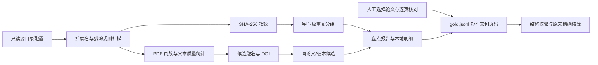

# S0 学习记录：资料盘点、文献版本与评测真值

## 本阶段要解决的问题

在做任何检索前，先回答三个问题：资料到底有哪些；哪些路径只是同一 PDF 的重复副本、哪些可能是不同版本；之后怎样判断检索是否找对原文证据。原始 PDF 全程只读，本阶段不复制全文、不建立索引，也不调用模型 API。

## 数据流



每条 `gold.jsonl` 证据指针包含 `root_id + file_name + sha256 + pdf_page + quote`。因此文件被替换时旧指针无法悄悄指向新内容；路径也能从配置根目录复建。页码始终是 PDF 物理页码，后续展示时应写作“PDF 第 N 页”，不要把它冒充印刷页码。

## 关键文件、类与接口

- `configs/sources.example.yaml`：明确列出的六个资料根目录、扩展名和排除目录；另列合并 BibTeX。新增目录必须由人显式配置。
- `papertrail/audit.py`：`inspect_file` 计算文件哈希、类型、大小、PDF 页数、文本页比例、扫描/低文本页、表格密集候选页、题名与 DOI 候选；`discover` 应用扫描范围与排除规则；`duplicate_groups` 将 SHA 完全重复与题名/DOI 相似候选分开；`render_report` 生成可审阅的完整清单。
- `papertrail/gold.py`：`load_gold` 校验 JSONL 字段、题型、ID、短引文长度、拒答题证据约束；`verify_quotes` 按来源根目录、文件哈希和页码重新打开 PDF，并核对短引文确实出现在该页。
- `evals/gold.jsonl`：34 条人工问题，20 条事实定位、5 条方法比较、2 条跨论文、1 条多跳、3 条冲突辨析、3 条不可回答。引用共 37 条，来自 10 个英文论文 PDF。问题用中文表达并保留关键英文术语；中文资料以阅读笔记为主，没有把笔记误标为英文论文原文。
- `docs/corpus-audit.md`：全部 148 个发现项的绝对路径、SHA-256、类型/类别、大小、页数、可解析比例、DOI/题名候选，以及异常、重复和表格页候选。
- `.local/corpus-inventory.jsonl`：供后续本地复查的逐文件结构化明细，含本机绝对路径；已加入 `.gitignore`，不提交。

## 原理与设计取舍

### 字节重复与论文身份分开

SHA-256 对文件字节计算。哈希相同可以证明两份文件完全相同，适合避免重复展示和重复解析；哈希不同只证明 PDF 文件不同，不能证明论文不同。改过元数据、重新压缩或换版的 PDF 都会得到不同哈希。

DOI 与规范化题名只生成“候选谱系”，不直接合并。DOI 可能是参考文献中的 DOI；题名可能被截断或被 PDF 元数据中的会议模板污染。本轮发现 17 组字节级重复，以及 2 组非重复的题名相似候选。Robust Detection 的 9 页与 16 页文件是版本复核候选，暂不自动折叠；CTGAN 的题名相似副本也要人工确认。

### 页级可解析率是筛查信号，不是解析质量证明

本轮用 PyMuPDF 统计每页至少 12 个词元的页占比，以零星图像页/扫描页为筛查目标。`table_dense_pages` 是对竖线和多列空白对齐的简单启发式。它能提示抽样位置，但 PDF 的双栏排版、公式和代码块也会触发；真正的表格结构保留要到后续解析评估才能判断。正文未保存，抽取文本只短暂存在内存中用于统计与原句核验。

### S0 的检索基线设计

后续 S1 先用 SQLite FTS5 BM25 建立确定性关键词基线，目标是 DOI、题名、专有方法词和精确短语的可追溯召回；记录问题级 top-5 是否包含目标证据页，形成 Recall@5。选择 FTS5 是为了易复建、离线可跑、能看懂检索词命中，当前不引入向量模型、重排或 API 费用。中文连续词与英文 PDF 的中英混合检索可能被分词方式限制，这要作为失败类别单独记录，之后再用同一黄金集验证向量检索是否有实际收益。

## 两条失败路径

1. **重复 PDF 被误认为不同论文或版本被误合并。** 同哈希可安全判为字节重复；不同哈希的标题/DOI 相似只能标候选。本轮有同一 Robust Detection 论文的不同页数 PDF，也有引文/阅读汇编；如果只按 DOI 并集群，会把“引用了该 DOI 的笔记”误并成同一论文，所以版本候选排除了阅读笔记 PDF，并要求标题相似度。
2. **文字统计通过但页面仍不可用。** 1822/1822 页达到本轮词元阈值，不代表表格、公式、双栏阅读顺序正确，也不代表没有嵌入的网页错误页。`2024_Nature_AI_Models_Collapse.pdf` 被标为疑似网页拦截页，必须人工确认；可解析比例为 100% 也不能把它算作论文成功解析。
3. **DOI/题名抽取错把参考文献当本文元数据。** 当前 PDF DOI 只从前两页提取，仍可能误报。报告把它们叫候选并要求人工校对；后续可用首屏版面位置和 BibTeX 对照减少误报。

## 测试命令与真实结果

盘点原始文献（只读源路径；明细写入被忽略的 `.local/`）：

```powershell
python -m papertrail.audit --sources configs/sources.example.yaml --out docs/corpus-audit.md --inventory-out .local/corpus-inventory.jsonl
```

结果：`files=148 pdf=88 exact_duplicate_groups=17`。其中 88 条 PDF 路径记录折叠为 67 个独立内容哈希；PDF 总页数 1822，可提取文本页比例 100%。另识别出 1 个疑似网页拦截 PDF、2 组同论文/版本待人工核对候选。运行时 MuPDF 输出了两条内嵌样式 CSS 解析告警；PDF 没有读取失败，但已将可疑网页页单独标出。

黄金集检查：

```powershell
python -m papertrail.gold --sources configs/sources.example.yaml --gold evals/gold.jsonl
```

结果：`questions=34 types=conflict,cross_paper,fact_location,method_comparison,multi_hop,unanswerable evidence_quotes_verified=37`。这一步逐条核验了每个引用的哈希、PDF 页码与短引文。

测试：

```powershell
python -m pytest -q
```

结果：`4 passed`。覆盖标题规范化、大小写无关排除、目录扫描、重复哈希、表格候选页、黄金集约束和真实 PDF 引文定位。测试没有证明 S1 检索效果；当前还没有检索器或 Recall@5 测量值。

## 10–20 分钟亲手实验

1. 在 `docs/corpus-audit.md` 找一个完全重复组，复制两条绝对路径。
2. 在 PowerShell 运行 `Get-FileHash -Algorithm SHA256 -LiteralPath '<路径一>'` 和对路径二重复运行；核对结果都与报告哈希一致。两份 PDF 都只打开查看第一页，不要另存或移动。
3. 查看 Robust Detection 的“同论文/版本候选”：9 页文件与 16 页文件应有不同 SHA-256，但题名相似。对照两份 PDF 的目录/附录，判断它们是版本变化还是同稿不同排版。
4. 将你的判定写入 `.local/version-review.md`（不要写入论文内容），再运行 `python -m papertrail.gold --sources configs/sources.example.yaml --gold evals/gold.jsonl`。

预期现象：完全重复组的 SHA 一致；版本候选的 SHA 不同；相似题名不足以单独证明版本关系。若本机路径不可用，先检查 `configs/sources.example.yaml`，只修正副本配置中的路径，不触碰源文件。

## 面试追问

**问：为什么不直接用 SHA-256 作为 Paper ID？**

答：SHA 标识具体文件版本，能精确去重；同一论文重新排版就会换哈希。PaperTrail 需要把 `Paper` 身份和 `PaperVersion` 文件版本拆开，后续再结合 DOI、题名、作者和人工确认建立谱系。

**问：为什么保留来源路径和哈希，而不把所有 PDF 复制进项目？**

答：路径让用户能在授权位置打开原文，哈希证明黄金集指向的文件版本；不复制原始资料可降低隐私、存储和误提交风险，也使索引可由用户自己的文献重建。

**问：页级文本比例 100% 是否说明 PDF 解析已完成？**

答：不是。它只说明各页超过一个最小文本量阈值。阅读顺序、表格结构、印刷页码、扫描图像和网页拦截页仍需检查；S0 的结果只用于筛查并选择解析样本。

## 收益与未完成项

- 已测得：88 条 PDF 路径压到 67 个独立字节流；黄金集有 34 个问题、37 条原文指针，全部可回到源 PDF 页；目前没有扫描/低文本页候选。
- 未测得：检索 Recall@5、向量模型收益、OCR 质量、表格结构恢复率、端到端回答准确度。没有运行有费用的模型 API。
- 未完成：人工确认 2 组版本候选、人工查看网页拦截 PDF；在黄金集中补足中文原文论文问题（当前中文表达为混合问法，原文证据以英文论文为主）。
- 停止点：S0 交付已完成。下一阶段 S1 必须等用户亲手实验、提问或明确说“继续”。
